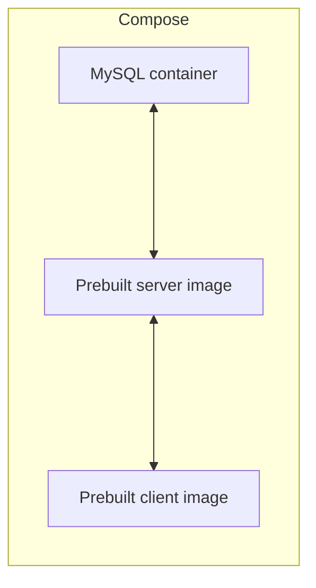

<div align="center">

# 🥗 Adria — Test Environment

**Docker Compose configuration for integration testing: MySQL + prebuilt server and client images.**


</div>

> 🎓 Created as part of a simulated 2084 "Return to Earth" startup coursework: reproducible integration environment for NutriScan testing.


## 📖 About

- Test environment is defined in `test-environment/docker-compose.yml`.
- Starts a MySQL container and pulls prebuilt server and client images referenced by the compose file.


## 🏗️ Architecture




## ✨ Features

- Reproducible integration environment using Docker Compose
- Healthcheck configured for MySQL container
- Uses image tags defined in the compose file (see below)


## 🛠️ Tech Stack

| Area | Technologies |
|------|--------------|
| Container orchestration | Docker Compose |
| Database | MySQL (8.0) |
| Images | prebuilt images referenced in compose |


## 🚀 Getting Started

### Prerequisites

- Docker & Docker Compose


### Run

```bash
cd test-environment
docker compose -f docker-compose.yml up -d
```


### Notable compose entries

- `database.adria` — `image: mysql:8.0` (container_name: `database-adria-nutriscan`)
- `server.adria` — `image: hcr.technet.howest.be/adria-server-group-08:latest` (container_name: `server-adria-nutriscan`)
- `client.adria` — `image: hcr.technet.howest.be/adria-client-group-08:latest` (container_name: `client-adria-nutriscan`)


## 🔧 Configuration / Env files

| File | Purpose |
|------|---------|
| `.adria-database.test.env` | Environment file used by `database.adria`. An example file is provided as `.adria-database.test.env.example` with common values (copy and edit before use). |
| `.adria-server.test.env` | Environment file used by `server.adria`. An example template is provided as `.adria-server.test.env.example` — populate it with the variables required by your server image. |

### Example files

Copy the example files and fill any secrets before running the compose environment:

```bash
cp .adria-database.test.env.example .adria-database.test.env
# edit .adria-database.test.env if needed

# copy server env template and populate required variables
cp .adria-server.test.env.example .adria-server.test.env
# edit .adria-server.test.env to include connection strings or other required variables
```


## 👤 Author

| Name | GitHub | LinkedIn |
| --- | --- | --- |
| Maurice De Kegel | [MriceDK](https://github.com/MriceDK) | [LinkedIn](https://www.linkedin.com/in/dekegelmaurice/) |

